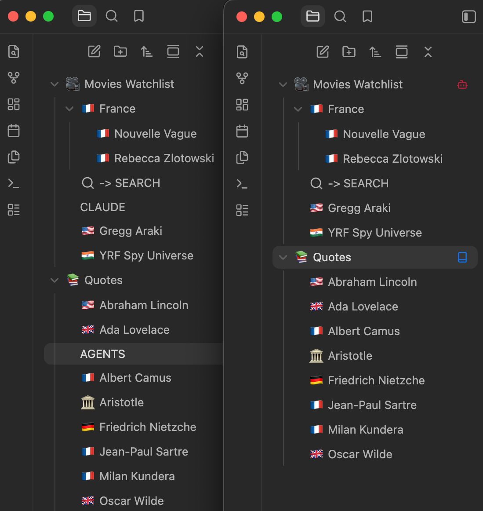
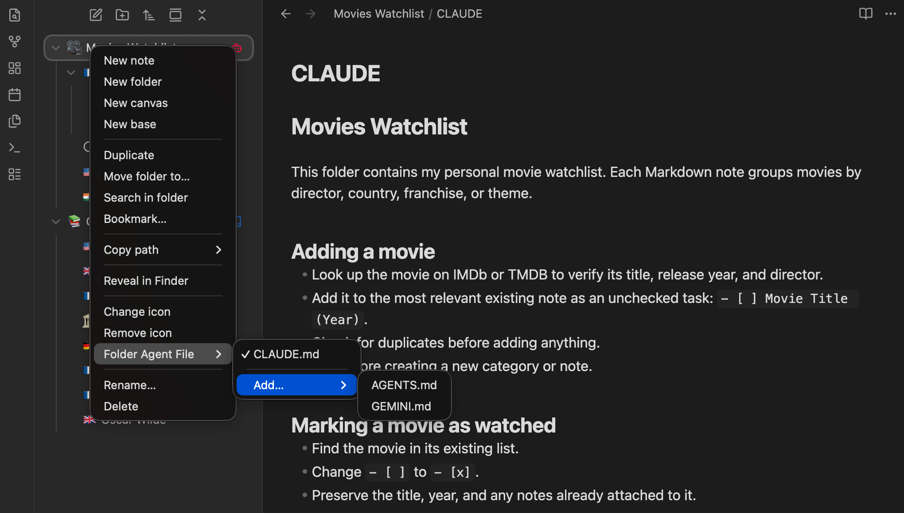
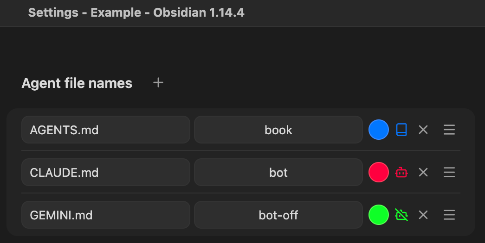

# Folder Agent



Folder Agent hides AI agent instruction files from the Obsidian file explorer
and marks the folders that contain them with an icon that opens the active
agent file.

It is agent agnostic: nothing is special-cased for any particular tool, you
only configure which file names may hold agent instructions.

## What it does

- Hides every configured agent file from the file explorer. The files stay
  normal vault files: they are never moved, renamed, or deleted, and they
  remain reachable through search, links, the quick switcher and every Obsidian
  API.
- Shows one icon next to every folder that contains at least one agent file,
  regardless of how many it contains. Clicking the icon opens the folder's
  active agent file; clicking the folder itself keeps its normal behaviour.
- Adds a **Folder Agent File** submenu to the folder context menu, which lists
  the agent files of that folder (marking the active one) and can create new
  ones.



## Configured agent file names

The plugin keeps an ordered list of file names in
**Settings → Community plugins → Folder Agent**. The default is `AGENTS.md`,
but any file name works, for example:

1. `AGENTS.md`
2. `CLAUDE.md`
3. `GEMINI.md`



The order defines precedence. If a folder contains several of them, the first
existing file in the list is that folder's **active** agent file, and it is the
one the folder icon opens. In the example above a folder holding `AGENTS.md`
and `GEMINI.md` shows a single icon that opens `AGENTS.md`, while both files
stay accessible through the context menu.

Nested folders are independent: each folder resolves its own active file.

The vault is the only source of truth. Folder Agent keeps no per-folder
registry, so creating, renaming or deleting files on disk updates the file
explorer immediately.

### Per-name appearance

Each configured name can override the icon (any icon from
[Lucide](https://lucide.dev/), the icon set Obsidian ships with) and its
colour. Typing in the icon field autocompletes the icon names Obsidian knows.
A folder uses the appearance of its currently active agent file, and
`bot` with the theme's own icon colour is the default. Changes are applied
immediately, and reordering names changes which file a folder icon opens.

## Folder Agent File context menu

Right-click a folder in the file explorer:

```
Folder Agent File
  ✓ AGENTS.md
    GEMINI.md
  Add…
    MY-AGENT-CONFIG.md
    .COPILOT.config
```

- The check mark marks the active agent file.
- Clicking any listed file opens that file, even if it is not the active one.
- **Add…** lists the configured names that do not exist in that folder yet.
  Picking one creates an empty file with that exact name and opens it; existing
  files are never overwritten. When every configured file already exists, no
  **Add…** submenu is shown.

## Development

This project uses TypeScript with the Obsidian type definitions and esbuild.

```bash
bun install       # install dependencies
bun run dev       # watch build to main.js (for local development)
bun run build     # type check, production build, refresh dist/
bun run lint      # oxlint + eslint (eslint-plugin-obsidianmd)
bun run release   # lint, then the production build
```

To try it out, put this repository into a vault as
`<Vault>/.obsidian/plugins/folder-agent/`, run `bun run dev`, and enable the
plugin in **Settings → Community plugins**.

A production build also assembles `dist/`, which contains exactly the three
files a plugin release consists of:

```
dist/
  main.js         # production bundle
  manifest.json   # copied from the repository root
  styles.css      # copied from the repository root
```

`dist/` is recreated from scratch on every build, so it never contains stale
files. Nothing in it is generated: `manifest.json` and `styles.css` stay
canonical source files in the repository root, and `main.js` is the bundle the
build produces in the root as well (which is what `bun run dev` writes while
watching).

Requires Obsidian 1.13.0 or later, because the settings tab uses the
declarative settings API introduced there. The plugin works only on desktop.

## Technical limitations

Obsidian has no public API for hiding files in the file explorer or for
decorating its rows. `src/file-explorer.ts` is therefore the only module that
touches the file explorer, and it does so as little as possible:

- It identifies rows by their `data-path` attribute, the long standing
  convention of the explorer markup, and by the `.nav-file-title` and
  `.nav-folder-title` class names.
- It applies one class per hidden file (`.folder-agent-hidden`, styled in
  `styles.css`) and appends one small element per folder icon. Both are driven
  by a single `MutationObserver` per file explorer, because the explorer
  recreates rows while scrolling and expanding.
- Clicks on a folder icon are handled by one delegated listener per explorer in
  the capture phase, so that the folder does not toggle at the same time.
- Everything it creates is removed when the plugin unloads, which restores the
  normal file explorer without restarting Obsidian.

The nested **Add…** submenu uses `MenuItem.setSubmenu()`, which exists in
Obsidian but is not part of the public API. It is feature detected inside a
guarded call, and if it is missing or throws — as on an Obsidian version that
drops it — the same entries are added to the parent menu instead, so the
**Folder Agent File** entry itself always stays available.

Folder context menus are extended through the documented `file-menu` workspace
event, which the file explorer also fires for folders. Its `source` argument
carries undocumented values, so it is deliberately not filtered on; the entries
therefore also appear in folder context menus of other Obsidian views (search
results, quick switcher), which is harmless.

Because rows are matched by their `data-path` attribute, a row whose attribute
Obsidian has not updated yet (a known quirk when a folder is renamed) can keep
its previous state until the explorer re-renders that row. Collapsing and
expanding the folder, or reloading Obsidian, resolves it.

## License

MIT